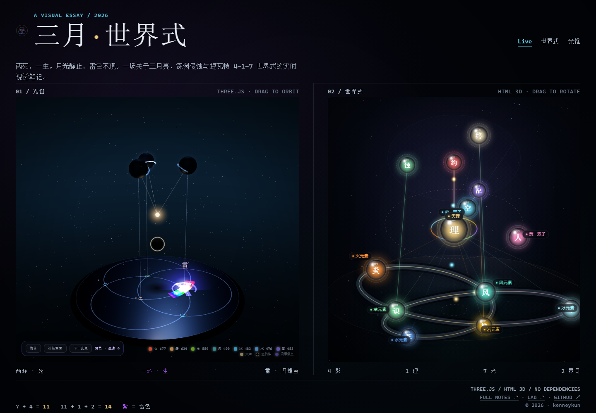

# 三月 · 世界式

> 两死，一生。月光静止，雷色不现。

**线上站：[kenneykun.github.io/genshin347puzzle](https://kenneykun.github.io/genshin347puzzle/)**

这里用“三月”而不是“三光”：三月亮本身不发光，我们看到的是它们反射的月光。

这是一套从三环几何、十四席计数和雷神之眼停发现象反推的视觉猜想。不是官方设定。



## 这版在做什么

把“中心锥形晶体分光”换成一套**有光学词汇支撑的象征模型**：

- **删除中心锥体**，不再有中心导光体；
- **天理**是底色盘上方的点光源，被**日食遮挡**，直射光到不了盘心；
- **三月**保持弧面形态，作为**唯一的分光元件**在阴影外接收天理光，反射衍射到底色盘，同时承担中继照明；
- **雷色**不再是独立移动的紫色谱带，而是**光栅转动时扫过交点的闪耀高亮**；
- **三环圆形不动**——凯尔特三圆环是基础设定，不为了光学合理性去改几何。

**边界先说明白：这是象征模型，不是物理仿真。** 不做光线追迹，不声称光学上精确；底色盘的七色是**光栅预设分区**，不是实时色散结果；天理与日食是叙事化照明。可调参数都是设计选择，不是自动成立的结果。

## 公式

```text
7 光 + 4 影 + 2 界间 + 1 天理 = 14
7 + 4 = 11
11 + 1 + 2 = 14
```

这里的 **7 光**是七个波长（七元素的象征色对应七个波段，见〈七元素色板〉）：

- 火 677 / 岩 634 / 草 559 / 风 490 / 冰 483 / 水 476 / 雷 453 nm —— 它们落在各自光栅的光谱弧上，位置由光栅方程决定，与六个交点无关。
- **雷**是其中唯一会移动的那个：它不是固定色块，而是闪耀波长的像点，沿罗兰圆移动；它的像点扫过哪个交点，哪个交点才闪。
- **4 影**：死、生、时、空。
- **2 界间**：`02 空`、`13 人`。双子不是一层。
- **1 天理**：`01 理`。它在光与影之间，在几何上是那盏被遮挡的光源。

这套十四席也用来对照《崩坏》侧的十四位律者；逐席对应是解释性的，不是官方名单。

## 核心猜想

1. **14 不是 7+7，而是 7+4+2+1。** 七光、四影、双子和天理分属不同层级。
2. **七个光 = 七个波长，不是六个交点加一个雷。** 三环上的六个交点只是几何交点；七元素是七个波长，落在各自光栅的光谱弧上。
3. **雷是闪耀像点，不是色块。** 光栅转动 → 入射角变化 → 闪耀波长沿罗兰圆移动；它的像点扫过哪个交点，哪个交点才闪。
4. **静止 = 雷色不现。** 两个死月固定两环，活月的光栅也静止；入射角不变，闪耀波长不扫动，就没有雷。
5. **紫是雷色，不是深渊本体。** 深渊/槲寄生是“把光栅钉住”的原因；紫色本身是雷色。
6. **反主不能坐雷位。** 雷已经没有固定座位；反主只能占 `02 空 / 13 人` 的界间位，卡住光路。
7. **天理在光与影之间。** 不是把天理放到影的背后，而是让 `01` 成为四影与七光的接触面，同时是唯一的光源。

## 三环解

```text
外三角半径 R = 7
内三角半径 r = 3.5
环半径 ρ = √(R² − Rr + r²)
         = √36.75
         ≈ 6.0622
```

注意一个恒等式：**ρ = r√3 = 内三角的边长**。
所以每个环都经过另外两个月心（|AB| = |AC| = ρ）——这不是装饰，而是罗兰圆判据要用的几何前提，见〈三环 = 罗兰圆〉。

三个环心：

- A：风 `(3.03, −1.75)`
- B：岩 `(0, 3.5)`
- C：草 `(−3.03, −1.75)`

六个两两交点：

```text
A ∩ B：冰、草
B ∩ C：水、风
C ∩ A：火、岩
```

六个点都是固定节点；**三环中心没有第七个节点**。

颜色角度（世界坐标，从 x 轴逆时针）：

```text
冰：A60 / B0        水：B180 / C120
火：A240 / C300     草：A180 / B240
风：B300 / C0       岩：A120 / C60
雷：没有固定角度；由光栅闪耀窗口扫过
```

每个固定交点上的两个环必须同色。  
雷是唯一例外：它是移动的闪耀色，可以暂时覆盖一个交点，不需要另一条环也变成紫色。

### 交点方位角

六个交点在盘面上**每隔 60° 一个**，这是后面“同一时刻最多一个雷”的几何根据：

| 交点 | 坐标（世界） | 方位角 |
|---|---|---:|
| 冰 | `(6.0622, 3.5)` | 30° |
| 岩 | `(0, 3.5)` | 90° |
| 水 | `(−6.0622, 3.5)` | 150° |
| 草 | `(−3.03, −1.75)` | 210° |
| 火 | `(0, −7)` | 270° |
| 风 | `(3.03, −1.75)` | 330° |

其中三个交点与环心重合（草 = C 心、风 = A 心、岩 = B 心）——这是三环几何本身决定的，不是笔误。

## 七元素色板

贴官方七元素视觉色，**原色**与**深色变体**两套（演示页左侧参数面板可一键切换）。

| 元素 | 键 | 原色 | 深色变体 |
|---|---|---|---|
| 火 | `fire` | `#EC4923` | `#E53D29` |
| 水 | `water` | `#498FCC` | `#0086D2` |
| 风 | `anemo` | `#359697` | `#009397` |
| 雷 | `thunder` | `#6957C2` | `#5E45D2` |
| 草 | `grass` | `#66AD16` | `#4AA400` |
| 冰 | `ice` | `#35AACC` | `#00A6CE` |
| 岩 | `geo` | `#CC9046` | `#CF8620` |

雷色分两层：实色 `#6957C2`，发光/晕染 `#7B66E2`。发光层强度由闪耀遮罩平滑驱动，不用固定透明度。

### 取色与插值的三条实现约束

1. **色相在 sRGB 空间插值。** 线性空间里 `geo`(24°)→`water`(217°) 的色相差会跨过 0.5，最短路径会绕道品红；sRGB 空间下是 177°，从黄绿青走过去。
2. **环上不允许出现紫。** 环 A 的 `fire`(11°)→`ice`(194°) 恰好跨 182°，最短路径仍会穿紫区；实现里在两条路径中优先选不穿紫（238°–342°）的那条。紫色只由雷色层提供。
3. **元素色材质 `toneMapped: false`，工作色彩空间 sRGB。** 否则 ACES 色调映射会把 Hex 拉走。

## 三环 = 罗兰圆（几何 ↔ 光学）

这是本模型里几何与光学唯一的接口，也是它成立的理由。

凹面光栅的罗兰圆：曲率半径 `R` 的凹面光栅，其罗兰圆半径是 `R/2`，并且**经过光栅顶点**。
把它套到三环上：

```text
ρ = r√3 = 内三角边长 = 6.0622
R = 2ρ = 12.1244          ← 三月光栅的曲率半径
罗兰圆半径 = R/2 = ρ = 6.0622   ← 正好就是环半径
```

因为 `|AB| = |AC| = ρ`，**每个环都经过另外两个月心**——也就是"环 A 就是月亮 B/C 那面光栅的罗兰圆"这件事在几何上是成立的。三环不是三根装饰圆，而是三月各自光栅的罗兰圆：**环上每一点都是某个波长的像点。**

（严格罗兰条件还要求光源也在罗兰圆上；天理不在任何一条环上，所以这是设计参考，不是精确追迹。）

### 环上只有一段有光

光栅方程 `d(sinα + sinβ) = mλ`，取 `d = 500 nm`、`α = 30°`、`m = +1`：

| λ | β（盘面极角） |
|---:|---:|
| 400 nm | 17.5° |
| 450 nm | 23.6° |
| 500 nm | 30.0° |
| 550 nm | 36.9° |
| 600 nm | 44.4° |
| 650 nm | 53.1° |
| 700 nm | 64.2° |

所以可见光在盘面上只占 **46.7°** 的弧，其余角度没有光；颜色沿弧从蓝到红单向排列。单级衍射的物理上限约 55°（`d` 取 700 nm、入射角 0°），弧不可能铺满整圈。

### 六交点不再是元素座位

两条罗兰圆的交点 = 两套光谱在同一位置叠加，是一个**真实的叠色事件**，不是"某个元素坐在这里"。
交点只保留几何意义；七元素是七个波长，位置由光栅方程决定，与交点无关。

### 只有活月在分光

两死月已经停转，只剩暗环；只有活月（C）的光栅还在工作，所以：

- 环上只有**一条**光谱弧；
- 闪耀像点只有一个，**同一时刻最多点亮一个交点**——"一次只有一个雷"由此成立，而不是靠人为窗口。
## 光学链路

```text
三月弧面光栅（最上方，唯一分光元件）
   ↑ 上行光
天理点光源（中间，沿三环公共法线）
   ↓ 直射下行光被遮挡体挡住
日食遮挡体 → 盘心阴影（直射光到不了盘面）
   ↓
底色盘（只吃经三月中介的反射光）
```

职责重新划分：

| 元件 | 旧职责 | 新职责 |
|---|---|---|
| 中心锥形晶体 | 分光 / 导光 | **删除**，不保留中心导光体 |
| 天理 | 无 | 底色盘上方的点光源，被日食遮挡 |
| 日食遮挡体 | 无 | 挡住天理直射光，形成中心阴影锥 |
| 三月 | 象征性镜面 | 弧面反射式闪耀光栅，唯一分光元件 + 中继照明 |
| 三环 | 几何骨架 + 分段着色 | 几何骨架 + 分段着色 + 径向刻线 |

### 三环整体是光栅载体，三月是驱动节点

- **三环整体是弧面光栅载体**：环本身就是弧，刻线就刻在环上；
- **三月是环心处的弧镜 / 月相节点**：负责在阴影外接光、把光中继到底色盘，不是三块孤立的小镜片；
- 演示里三月画成“暗月本体 + 受光月牙”：本体不发光，只有朝光源一侧的弧边亮起来。

## 天理与日食

| 参数 | 默认 | 范围 | 说明 |
|---|---:|---|---|
| 三月高度 | 10.4（≈1.7ρ） | 固定 | 最上方，天理之上 |
| 天理高度 `h` | 4.4（≈0.72ρ） | 2–9 | 中间，沿三环公共法线 |
| 遮挡体高度 | 盘面→天理的 `0.62` 处 | 随 `h` | 位于天理正下方 |
| 遮挡体半径 `r_o` | 0.22（展示单位） | 0.08–0.70 | 决定盘心阴影大小 |
| 盘面阴影半径 `R` | ≈0.58（展示单位） | — | `R = H·r_o / (H − H_o)` |

其中 `H = h − y_disk`、`H_o = 遮挡高度 − y_disk`。默认参数下阴影半径 0.58、三环半径 1.9399——**阴影只吃掉盘心**，三环留在阴影外；而三月在天理之上，本来就不在阴影锥里，它只接收上行光。

阴影半径随参数变化，不是自动成立的结果：`r_o` 调大或遮挡体压低，阴影会蔓延到环上，光栅就接不到光。这是设计选择，**几何参数必须一起调**。

象征含义：

> 天理不可直视、不可直射。盘面接收到的光必须经过三月的中介：直射的那部分被挡住，只有反射下来的才落在环上。

演示里阴影只画在盘面上（中心暗斑），不再画实心阴影锥：实心锥在暗场里会被读成一块黑幕，压掉三环。

## 圆心问题：罗兰圆与变栅距

三环是正圆，不能改。圆形带来的约束必须正面回答，而不是绕过去。

现实里的处理方式：

1. **罗兰圆条件（Rowland Circle）**  
   曲率半径 `R` 的凹面光栅，若入射狭缝、光栅中心、出射探测面落在半径 `R/2`、与光栅中心相切的圆上，各波长切向焦点落在该圆上，像差在宽波段内保持较小。圆心不是被消除，而是被纳入聚焦几何设计。
2. **变栅距刻线（Varied-line-spacing）**  
   刻线间距沿镜面按设计函数变化，补偿不同位置的像差。通过全息曝光或电子束光刻制作。
3. **全息曝光**  
   用球面波/非球面波干涉曝光，从源头写出变栅距图案。

本模型的落地方式：

- 不做追迹，只借用这套设计原则做**视觉与数据线索**；
- 刻线沿径向布置，密度沿弧做 ±10% 的平滑渐变；
- 三环半径 `ρ ≈ 6.0622` 可当作光栅曲率半径 `R` 的参考值，罗兰圆半径约 `ρ/2 ≈ 3.03`。实际交点并不严格落在罗兰圆上，因此这是**设计参考，不是精确光学布局**。

## 雷色：光栅旋转的涌现

旧版是“沿 C 环流动的 24° 紫色谱带”，本质是手动画一个紫色对象。新版改为**闪耀高亮**：

```text
光栅转角 θ_g 变化
→ 天理到光栅的入射角 α 变化
→ 闪耀波长 λ_B 扫过可见光谱
→ 当某交点的当前闪耀波长落入雷色窗口，该交点显示雷色高亮
```

遮罩计算（逐交点标量，开销极低）：

```glsl
float delta = mod(uGratingAngle - theta_i + 180.0, 360.0) - 180.0;
float thunderMask = 1.0 - smoothstep(thunderHalfWidth * 0.6, thunderHalfWidth, abs(delta));
```

| 参数 | 默认 | 说明 |
|---|---:|---|
| 光栅转角 `θ_g` | 240° | 0–360°，绕三环公共法线 |
| 转速 | 10°/s | 静止时 `θ_g` 不变 |
| 窗口半宽 `w` | 12° | 4–20° 可调 |
| 初始相位 | 240° | 距最近交点 30°，加载即无雷 |

性质：

- **同时最多一个交点。** 六个交点 60° 均匀分布，窗口半宽 ≤ 20° 时不可能同时覆盖两个；
- **静止即不现。** `θ_g` 不变 → 闪耀波长不扫动 → 没有交点进入窗口；
- **底色只由位置决定。** 光谱弧的颜色来自该位置对应的波长，闪耀只做叠加高亮，不反过来改弧的配色；
- **绕公共法线转**，保证每个交点的局部闪耀角都能周期性变化。只绕单环轴转，部分交点可能永远不满足闪耀条件。

## 为什么必须改成物理色带（数值校验）

把七元素按色相映射成近似波长（火 677 / 岩 634 / 草 559 / 风 490 / 冰 483 / 水 476 / 雷 453 nm，单位 nm），
再按弧向检查三条环的波长是否单调——真实反射光栅（m = +1）沿弧给出的应该是一条单调的光谱扫描。

| 环 | 弧上序列（角度 → 颜色 → 波长） | 结果 |
|---|---|---|
| A | 60 冰 483 → 120 岩 634 → 180 草 559 → 240 火 677 | 逆序 1 处（岩 634 → 草 559） |
| B | 0 冰 483 → 180 水 476 → 240 草 559 → 300 风 490 | 逆序 2 处 |
| C | 0 风 490 → 60 岩 634 → 120 水 476 → 300 火 677 | 逆序 1 处（岩 634 → 水 476），且岩在 240° 重复 |

三条都不单调。再按线性色散 `λ = a + b·θ` 拟合，判定系数 R² 分别是 **0.59 / 0.13 / 0.40**——
只有 A 勉强像一条光谱，B、C 拟合失败。

接着枚举全部 **5040 种**"元素 ↔ 波长次序"，并允许每条环整体反向（三面光栅朝向本来就可以不同）：
**没有任何一种次序能让三条环同时单调**。冲突很直接——A 要求 冰<岩<草<火，B 要求 冰<水<草<风，
C 要求 风<岩<水<火，三者两两矛盾。

最后用光栅方程 `d(sinα + sinβ) = λ` 反解栅距（取同一入射角 35°，结果与尺度无关）：
A 需要 430、B 需要 355、C 需要 430——B 与 A/C 相差 21%，**同一套栅距出不了三条环**。

结论：

> **三个色带不能同时由光栅正确呈现。** 它们是"光栅预设分区 / 象征色"，不是单级衍射的结果；
> 能由光栅解释的只有**闪耀窗口沿环扫过**（角度条件），这与色带分区无关。

真要改成物理自洽，只有两条路：

1. 每条环变成真正的单级光谱（颜色沿弧单调、并留一条接缝）——代价是交点颜色不再等于固定元素色；
2. 承认这是三面**栅距不同**的光栅——代价是"同一套光栅"这个说法要收回。

因此模型采用物理色带：颜色由 `d(sinα+sinβ)=mλ` 直接给出，交点不再预设元素色。旧的七色分段（"象征分区"）已经退役，代码留在 `?sym=1` 作为对照存档，不再代表模型。
## 色带：真实衍射结果（默认）

**这是默认模式。** 三条环不再是七色分段，而是光栅的衍射输出；参数固定：

| 参数 | 值 |
|---|---|
| 栅距 `d` | 500 nm |
| 入射角 `α` | 30° |
| 衍射级 `m` | +1 |
| 可见光范围 | 400–700 nm |
| 盘面张角 `Δβ` | **46.7°**（400 nm → 17.5°，700 nm → 64.2°） |

由此得到四件事：

1. **每条环只有 46.7° 的弧被照亮**，弧内颜色就是 `d(sinα+sinβ)=mλ` 给出的波长色，蓝→红单向排列；
2. 弧随光栅转角整体旋转——色散图样跟着光栅转，这就是"光栅在转"的物理读数；
3. **交点不再有固定元素色**。交点只是三条环的几何交点；那一刻落在它上面的是什么波长，它就显示什么颜色；
4. **一条环上最多覆盖 1 个交点**（交点间距 60° > 张角 46.7°）；三面光栅各自独立，所以**同一时刻最多一个交点被点亮**——HUD 会把它们一起列出来。这比象征模式的"同时最多一个"更宽松，但它是物理上正确的那一个。

七个元素的波长在弧里的位置是固定的（火 677 → β=58.6°，岩 634 → 50.2°，草 559 → 38.2°，风 490 → 28.7°，冰 483 → 27.8°，水 476 → 26.9°，雷 453 → 24.0°），它们**不会正好落在交点上**——这正是"七色固定分区"无法同时成立的原因。

旧的七色分段已经退役；`?sym=1` 仍可打开存档对照，但它不是模型的一部分。
## 光学链路：多级衍射的象征映射（可选）

| 衍射级 | 象征 |
|---|---|
| `m = +1` | 七光 |
| `m = −1` | 四影 |
| `m = 0`（镜面反射） | 界间 / 天理的白光中心 |

实现上只取主级，这层映射只写进文档。

## 雷神之眼为什么停发

```text
两个死月 → A/B 两环固定
活月被槲寄生钉住 → C 环的光栅不再转动
入射角不变 → 闪耀波长不扫动
→ 没有交点进入雷色窗口
→ 雷色不现
→ 雷神之眼停发
```

这里不再需要“中心闭合”。  
中心空着；雷的缺失不是中心黑了，而是**光栅停了，闪耀窗口没有经过任何交点**。

### 槲寄生实验的硬约束

如果“冰之女皇用槲寄生对少女（月神）做实验”的剧情成立，它必须是：

> **寄生 / 冻结 / 维持，不能是杀死。**

如果少女/月神被杀死，C 环也应该死，画面就变成“三死”，不是“两死一生”。  
槲寄生是寄生植物，不立刻杀死宿主，正好对应“活月还亮着，但光栅不再转动”。

冰之女皇的动机可以有两种读法：

- **控制**：把最后一个活月变成可控制的固定光源；
- **保存**：用寄生维持最后一个活月，代价是它不再运动。

结构只判定“必须冻结”，不判定动机。

### 空月之歌的预测

如果《空月之歌》结束、月亮回归、光栅重新转动：

- 闪耀窗口会再次扫过交点；
- 雷色会重新出现；
- 雷神之眼可能恢复发放。

可证伪：

- 月亮仍静止，雷眼却恢复 → 静止说失败；
- 月亮回归，雷眼仍不恢复 → 还需要别的条件；
- 闪耀窗口扫过交点，但没有出现雷 → “交点闪耀”说失败。

## 四影与双子

| 四影 | 对应元素 | 读法 |
|---|---|---|
| 死 / 约 | 雷 | 死亡与契约，对应移动的闪耀色 |
| 空 / 配 | 岩 / 地 | 空间与配位，落在稳定的大地 |
| 生 / 识 | 草 | 生命与意识，落在草的生长 |
| 时 | 风 | 时间与流动，落在风 |

`10 空` 是四影里的空之执政；`02 空` 是双子里的空。两者不是同一个节点。

双子不是第三层，也不是七光之一。它们可以移动、可以挡路，但不能改变 `7+4+2+1` 的计数。

## 在线演示

### 左侧：光栅场景（`docs/prism_three_planb.html`）

- 三月悬在最上方（暗月本体 + 受光月牙），天理是中间的点光源，遮挡体在它正下方，盘心落一块阴影；
- 盘面中心阴影斑（半径由遮挡几何算出）；
- 三面“暗月本体 + 受光月牙”的弧镜；三条环保留为暗色基础圆，只有被光栅照到的 46.7° 弧显示真实光谱；
- 三环径向刻线（168 条，带变栅距暗示）；
- **闪耀像点扫过交点时**，只有交点环、辉光、火花弧与「雷」字标签亮起——没有任何竖直光柱（光不会从盘面往上射），全部由 `thunderMask` 平滑驱动；
- **活月（C / 草）的月牙会随光栅转角盈亏**：240° 最满、120° 最细；两个死月的月牙固定不动——这就是“两死，一生”的可视读数。

面板参数：

| 控件 | 作用 |
|---|---|
| SUN HEIGHT | 天理高度（世界单位） |
| ECLIPSE | 日食遮挡半径（展示单位） |
| GRATING ANGLE | 光栅转角，拖动即改变闪耀窗口 |
| THUNDER | 雷色窗口半宽 |
| RING BRIGHTNESS | 三环亮度（两死一生） |
| PALETTE | 原色 / 深色变体 |
| **旋转 / 冻结** | 光栅转动开关：冻结后入射角不变，闪耀窗口停止扫动，雷色不现 |
| **冻结重置** | 一键回到算出来的无雷态：光栅 240°、暂停、活月相位回到最满 |
| **下一交点** | 跳到下一个交点正对窗口的角度（逐个演示六个交点） |
| 日食 | 遮挡体显隐 |
| 标签 / 刻线 | 图层开关（交点是中性编号 1–6，不再标元素名） |

默认**冻结在 240°**：加载时没有雷，HUD 显示“雷色 · 不现”，并给出光谱弧张角与活月相位（240° 时为 1.00）。点“旋转”后，雷色会依次扫过六个交点（10°/s，一圈 36 s）；任何时候点“冻结重置”都会回到那个特定的无雷解。

站点首页里那颗 iframe 是嵌入模式（`?visual=1`），整套参数面板会被隐藏；为此嵌入模式自带一条常驻控制条（左下角：旋转 / 冻结重置 / 下一交点 / 当前雷色）。地址栏也可以直接钉住角度：`?blaze=30` 让雷落在冰交点，`?still=1` 冻结运动，`?visual=1` 进入无面板的嵌入模式。

### 右侧：世界式十四节点图（`docs/world_formula.html`）

这张 HTML 3D 图已经按新模型重绘：

- **三环中心留空**，只画一个虚线空位环，标注旧的“中心雷”座位已经取消；
- 七元素层是 **六个几何交点**：按 60° 均匀排布，只是三圆交点，不预设元素色；`03 雷` 平时不可见；
- `03 雷` 由同一个闪耀窗口驱动：窗口扫到哪个交点，它就临时出现在哪个交点的上方（并带高亮），扫不到时整体隐藏——与左侧场景共用同一套 12° 窗口和 10°/s 转速；
- 四影—元素对应线保留 `11→03、10→09、12→08、14→04`，其中指向 `03 雷` 的那条会跟着移动的雷位走；
- “三光源 / 一锥镜”的旧光路卡换成“一日食 / 三光栅”：天理点光源 → 日食遮挡 → 三面弧面光栅 → 底色盘。

地址栏可以加 `?blaze=270` 把闪耀窗口钉在某个角度（截图为 `?still=1&blaze=270`，此时火交点上的雷位亮起）。

`docs/world_formula_visual.html` 保留为 archive，不再代表当前模型。
## 尚待验证

这套模型仍需要对《空月之歌》的三月模型进行进一步验证。

需要特别核对：

- 两个死月的光谱是否真的固定；
- 活月的光栅是否真的被槲寄生钉住，而不是相位暂时不变；
- 闪耀窗口扫过交点时，是否真的只有一个交点成为雷；
- 空月之歌结束后，月亮回归是否会让雷色恢复。

在这些问题有答案之前，“闪耀雷色 + 光栅静止”只是目前更简约的解释，不是定论。

## 边界

- **几何事实**：三环半径、六个两两交点、`7+4+2+1=14` 的计数、交点 60° 分布。
- **结构选择**：雷从中心节点改成闪耀窗口；删除中心锥体；天理=被遮挡点光源；三月=弧面光栅。这些是为了解释“静止不现、流动出现”做的重定义。
- **叙事推测**：四影与元素的对应、雷眼停发的机制、槲寄生实验、反主与界面的关系。
- **光学措辞**：光栅方程、罗兰圆、变栅距是设计参考，不是本模型的推导；模型不做光线追迹，不声称物理上成立。

结构不是 canon。它只是把“为什么偏偏是雷”“为什么静止不现”“为什么窗口扫过交点才出现雷”放进同一张能自洽的图里。

## License

MIT，见 [LICENSE](LICENSE)。
